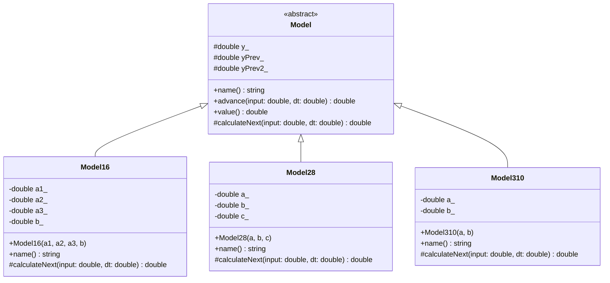
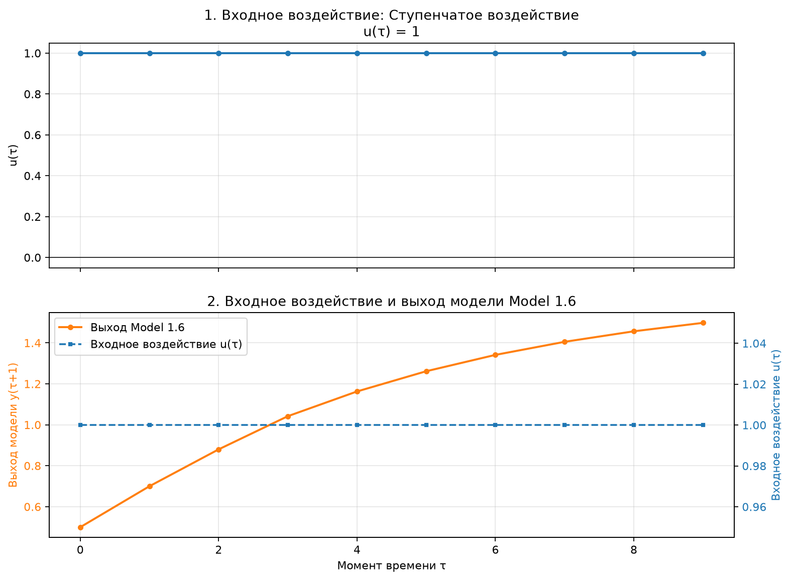
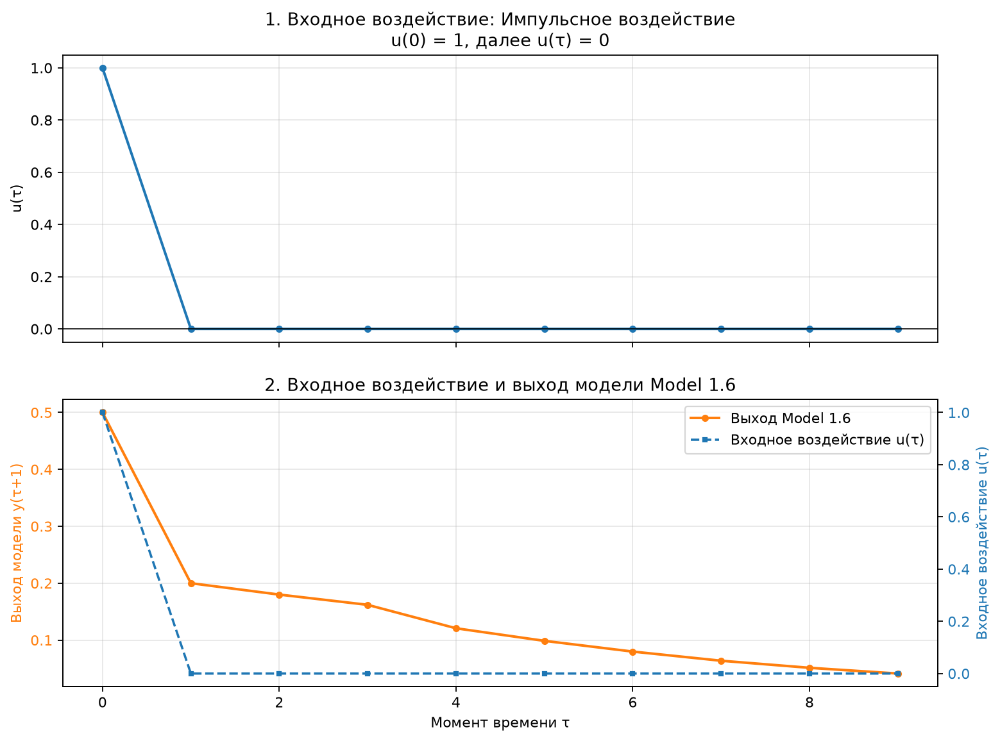
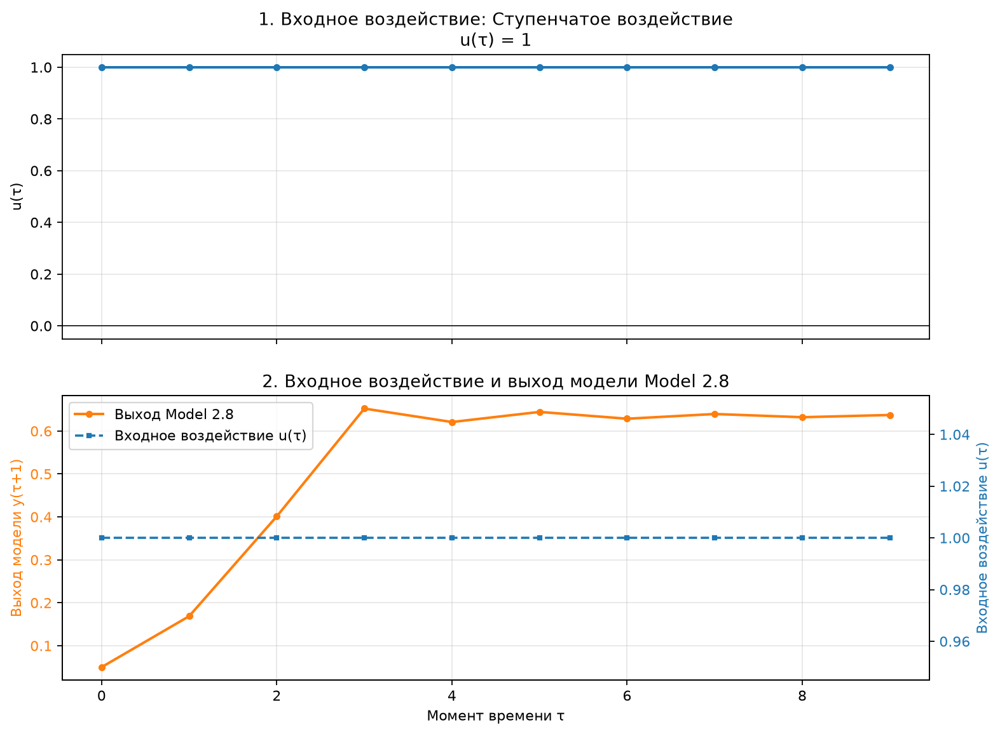
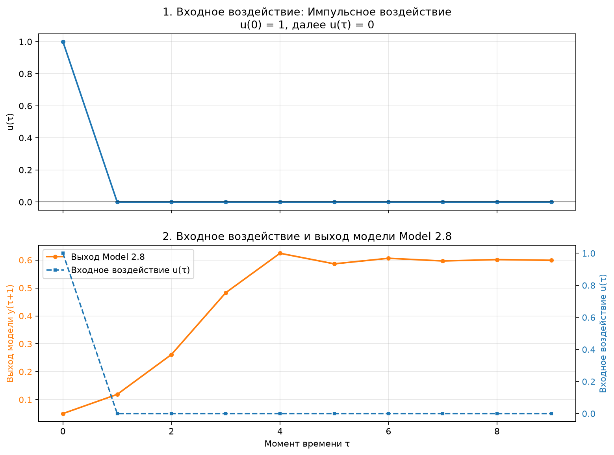
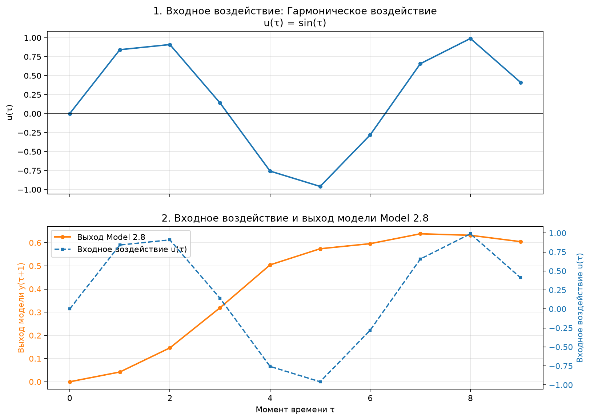
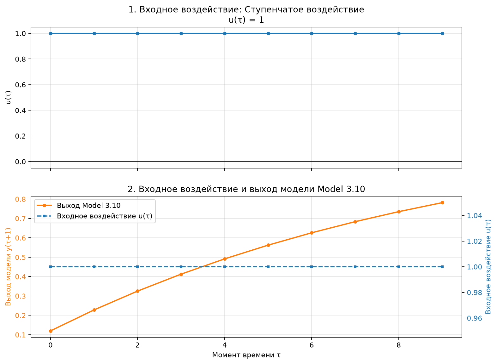
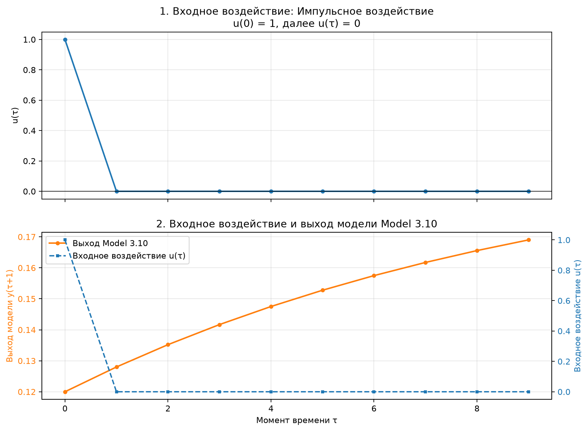
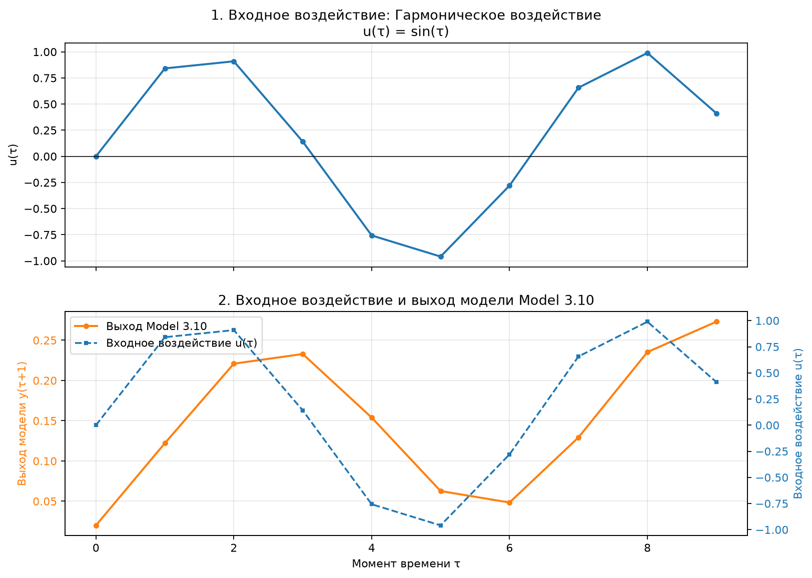

 <p align="center">Министерство образования Республики Беларусь</p>
<p align="center">Учреждение образования</p>
<p align="center"><strong>«Брестский государственный технический университет»</strong></p>
<p align="center">Кафедра ИИТ</p>

<br><br><br><br>

<p align="center"><strong>Лабораторная работа №1</strong></p>
<p align="center">По дисциплине «Теория и моделирование автоматического управления»</p>
<p align="center">Тема: «Моделирование объектов управления»</p>

<br><br><br>

<p align="right">Выполнил:</p>
<p align="right">Студент 3 курса</p>
<p align="right">Группы АС-68</p>
<p align="right">Ярмолинский И. В.</p>
<p align="right">Проверил:</p>
<p align="right">Дворанинович Д. А.</p>

<br><br><br><br>

<p align="center">Брест 2026</p>

---

# Вариант 6

- Линейная модель: **Model 1.6 (Динамическая система третьего порядка)**
- Нелинейная модель: **Model 2.8 (Возмущение логистического отображения с хаотической динамикой)**
- Дифференциальное уравнение: **Model 3.10 (Базовая модель с постоянным внешним смещением)**

## 1. Цель работы

Разработать программу на языке C++ для моделирования поведения объекта управления с использованием линейной, нелинейной и дифференциальной математических моделей.

Программа должна обеспечивать выбор модели и входного воздействия, ввод коэффициентов, настройку количества шагов симуляции, вывод результатов в табличном виде, экспорт данных в CSV и графическое отображение входного воздействия и выхода системы.

## 2. Используемые технологии

- **C++17** — реализация математических моделей.
- **ООП** — абстрактный базовый класс и классы-наследники.
- **CMake** — сборка проекта.
- **Batch** — автоматизация сборки и запуска.
- **Python 3 и Matplotlib** — визуализация результатов.
- **CSV** — сохранение расчётных данных.

## 3. Структура проекта

```text
task_01/
├── src/
│   ├── main.cpp
│   ├── ObjectModels.h
│   ├── charts.py
│   ├── CMakeLists.txt
│   └── build.bat
└── doc/
    ├── readme.md
    ├── class_diagram.puml
    ├── module_1.6_step.png
    ├── module_1.6_impulse.png
    ├── module_1.6_harmonic.png
    ├── module_2.8_step.png
    ├── module_2.8_impulse.png
    ├── module_2.8_harmonic.png
    ├── module_3.10_step.png
    ├── module_3.10_impulse.png
    └── module_3.10_harmonic.png
```

### Назначение файлов

- `main.cpp` — ввод параметров, выбор модели и воздействия, запуск симуляции, вывод таблицы и сохранение результатов.
- `ObjectModels.h` — абстрактный класс `Model` и реализации трёх математических моделей.
- `charts.py` — построение графиков по CSV-файлу.
- `CMakeLists.txt` — конфигурация сборки.
- `build.bat` — автоматический запуск сборки, симуляции и визуализации.
- `readme.md` — описание лабораторной работы и результатов.
- `class_diagram.puml` — исходный код UML-диаграммы классов.

## 4. Реализованные математические модели

### 4.1. Model 1.6 — линейная система третьего порядка

Уравнение:

$$
y_{\tau+1}
=
a_1y_\tau
+a_2y_{\tau-1}
+a_3y_{\tau-2}
+bu_\tau.
$$

Здесь:

- $y_\tau$ — текущее значение выхода;
- $y_{\tau-1}$ и $y_{\tau-2}$ — предыдущие значения выхода;
- $u_\tau$ — входное управляющее воздействие;
- $a_1$, $a_2$, $a_3$, $b$ — коэффициенты модели.

Модель учитывает текущее состояние системы и два предыдущих значения выходной переменной. Это позволяет исследовать влияние истории состояния на динамику объекта управления.

Коэффициенты задаются пользователем перед началом симуляции.

### 4.2. Model 2.8 — нелинейная логистическая модель

Уравнение:

$$
y_{\tau+1}
=
ay_\tau(1-y_\tau)
+bu_\tau
+c\sin(y_{\tau-1}u_\tau).
$$

Здесь $a$, $b$ и $c$ — коэффициенты модели.

Логистическое слагаемое $ay_\tau(1-y_\tau)$ создаёт нелинейную зависимость выхода от текущего состояния. Дополнительное слагаемое $c\sin(y_{\tau-1}u_\tau)$ учитывает взаимодействие предыдущего состояния с входным сигналом.

Поведение модели зависит от выбранных коэффициентов. Возможны ограниченные изменения выхода, колебания или расходимость расчётного процесса.

### 4.3. Model 3.10 — дифференциальное уравнение

Исходное дифференциальное уравнение:

$$
\frac{dy}{dt}=-ay+b+u.
$$

Для численного решения применяется метод Эйлера с шагом интегрирования $\Delta t$:

$$
y_{\tau+1}
=
y_\tau
+\Delta t(-ay_\tau+b+u_\tau).
$$

Здесь:

- $y_\tau$ — текущее значение выхода;
- $u_\tau$ — входное воздействие;
- $a$ и $b$ — коэффициенты модели;
- $\Delta t$ — шаг интегрирования.

Дискретная формула используется для последовательного вычисления выхода в каждом моменте моделирования.

## 5. Входные управляющие воздействия

Для тестирования моделей предусмотрено три типа управляющего сигнала.

### 5.1. Ступенчатое воздействие

$$
u_\tau=1.
$$

Сигнал сохраняет постоянное значение, равное единице, на всех шагах симуляции.

Такое воздействие позволяет исследовать реакцию модели на постоянный вход и наблюдать переходный процесс.

### 5.2. Импульсное воздействие

$$
u_0=1,
\qquad
u_\tau=0 \quad \text{при } \tau>0.
$$

На первом шаге подаётся единичный импульс, после чего входной сигнал становится равным нулю.

Этот режим позволяет исследовать поведение системы после кратковременного воздействия.

### 5.3. Гармоническое воздействие

$$
u_\tau=\sin(\tau).
$$

Входной сигнал меняется по синусоидальному закону. Значения вычисляются в дискретные моменты времени $\tau=0,1,\ldots,n-1$, аргумент синуса задаётся в радианах.

На графике входного воздействия должна отображаться синусоидальная зависимость. При этом выход нелинейной модели не обязан повторять её форму, поскольку определяется уравнением модели и выбранными коэффициентами.

## 6. Объектно-ориентированная архитектура

Программа построена на принципах объектно-ориентированного программирования.

Абстрактный класс `Model` определяет общий интерфейс математических моделей. Конкретные уравнения реализуются в классах-наследниках:

- `Model16`;
- `Model28`;
- `Model310`.

Основной код создаёт экземпляр выбранной модели и использует общий интерфейс для выполнения расчётов.

Метод `advance()` выполняет переход к следующему состоянию, а виртуальный метод `calculateNext()` реализуется каждым классом в соответствии с собственным математическим уравнением.

Таким образом, используется наследование и полиморфизм: механизм запуска симуляции общий, а вычисление следующего значения зависит от выбранной модели.

## 7. UML-диаграмма классов



На диаграмме представлен абстрактный базовый класс `Model` и три конкретных класса, реализующих соответствующие математические модели.

Обозначения UML:

- `+` — публичный член класса;
- `-` — закрытый член класса;
- `#` — защищённый член класса;
- `<<abstract>>` — абстрактный класс;
- стрелка с пустым треугольником — наследование.

Исходник диаграммы также хранится в `class_diagram.puml`.

## 8. Порядок работы программы

При запуске `build.bat` выполняются настройка проекта через CMake, сборка и запуск программы.

Пользователь последовательно вводит:

1. Количество шагов симуляции $n$.
2. Номер модели.
3. Тип входного воздействия.
4. Коэффициенты выбранной модели.

Для Model 1.6 вводятся $a_1$, $a_2$, $a_3$ и $b$. Для Model 2.8 — $a$, $b$ и $c$. Для Model 3.10 — $a$ и $b$.

После ввода параметров программа рассчитывает выбранную модель при выбранном воздействии, выводит таблицу результатов и сохраняет данные в CSV-файл.

Допустимое количество шагов — от 1 до 100000.

## 9. Формат выходных данных

Результаты симуляции сохраняются в `results.csv`.

| Столбец | Назначение |
|---|---|
| `signal` | Тип входного воздействия |
| `step` | Номер шага моделирования |
| `tau` | Дискретный индекс входного сигнала |
| `time` | Время после шага |
| `u` | Значение входного воздействия |
| `model` | Название выбранной модели |
| `y` | Рассчитанное значение выхода |

Файл CSV может использоваться для последующей обработки данных или построения графиков.

## 10. Результаты моделирования

Для каждой модели выполняется отдельная симуляция с выбранным типом входного воздействия. Визуализация содержит два графика в одном изображении:

1. Входное воздействие $u_\tau$.
2. Выход модели $y_{\tau+1}$.

На графике выхода также отображается линия входного воздействия, чтобы сравнивать управляющий сигнал и реакцию системы. Для входа и выхода используются отдельные вертикальные шкалы.

Ниже приведены изображения для всех девяти сочетаний моделей и входных воздействий.

### 10.1. Model 1.6 — линейная модель третьего порядка

#### Ступенчатое воздействие



#### Импульсное воздействие



#### Гармоническое воздействие


### 10.2. Model 2.8 — нелинейная логистическая модель

#### Ступенчатое воздействие



#### Импульсное воздействие



#### Гармоническое воздействие



### 10.3. Model 3.10 — дифференциальная модель

#### Ступенчатое воздействие



#### Импульсное воздействие



#### Гармоническое воздействие



## 11. Анализ результатов

Ступенчатое воздействие позволяет исследовать реакцию моделей на постоянный вход. Импульсное воздействие показывает, как меняется выход после кратковременного сигнала. Гармоническое воздействие позволяет оценить реакцию системы на периодически изменяющийся вход.

Линейная модель 1.6 учитывает текущее и два предыдущих значения выхода, поэтому её динамика определяется коэффициентами обратной связи и входного воздействия.

Нелинейная модель 2.8 демонстрирует зависимость поведения от состояния системы и выбранных коэффициентов. В зависимости от параметров её выход может изменяться нелинейно или расходиться.

Модель 3.10 рассчитывается методом Эйлера. Её реакция зависит от коэффициентов уравнения, шага интегрирования и входного сигнала.

При анализе графиков важно рассматривать входное и выходное воздействия отдельно. Синусоидальная форма входного сигнала не гарантирует синусоидальную форму выхода нелинейной модели.

## 12. Сборка и запуск

Для работы необходимы:

- CMake;
- компилятор C++17, например MSVC;
- Python 3;
- Matplotlib.

Для сборки проекта из папки `src` можно использовать команды:

```powershell
cmake -S . -B build
cmake --build build --config Release
```

Для автоматической сборки и запуска предназначен файл `build.bat`. Он выполняет конфигурацию CMake, сборку программы, запуск симуляции и построение графиков. При отсутствии Matplotlib скрипт пытается установить библиотеку автоматически.

При необходимости Matplotlib можно установить вручную:

```powershell
python -m pip install matplotlib
```

## 13. Ограничения реализации

- Коэффициенты задаются пользователем перед запуском симуляции.
- Нелинейная модель может расходиться при некоторых значениях коэффициентов.
- Программа проверяет корректность ввода и обнаруживает неконечные результаты расчёта.
- Дополнительное задание по аналитическому определению устойчивости и поиску корней характеристического уравнения не реализовано.

## 14. Вывод

В ходе лабораторной работы разработана программа на C++ для моделирования трёх математических моделей: линейной модели третьего порядка, нелинейной логистической модели и дифференциального уравнения.

Реализованы объектно-ориентированная архитектура, выбор математической модели и входного воздействия, ввод коэффициентов и количества шагов симуляции, табличный вывод, экспорт в CSV и визуализация результатов.

Построенные графики позволяют сопоставлять входные сигналы с выходами моделей и изучать особенности их динамики при различных типах управляющего воздействия.